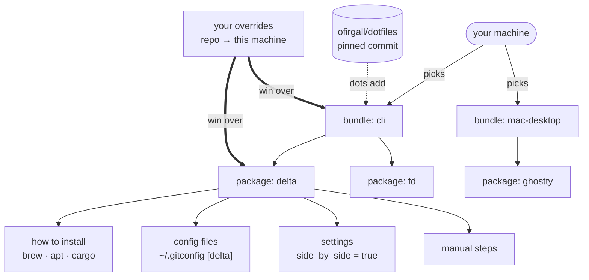

<div align="center">

# dotrobot

**Add someone else's bundle to your dotfiles: their tools and configs on your machine, your tweaks on top, their improvements whenever you `dots pull`.**

<sub>repo: <code>dotrobot</code> · CLI: <code>dots</code> · single Rust binary · macOS & Linux first · MIT</sub>

</div>

> [!IMPORTANT]
> **Spec-first: nothing to install yet.** This README is the v1 spec, and the console blocks show specified output. The full design is in [ARCHITECTURE.md](ARCHITECTURE.md) and [UX.md](UX.md), and progress is in the [roadmap](#roadmap).

## Why

Dotfiles tools today make you choose:
- **stow, dotbot, yadm** link files, but installing the software is up to you.
- **chezmoi** adds templates, and installs software through scripts you write.
- **home-manager** does everything, and even lets you import other people's modules, provided you move to Nix.

And sharing a setup still means copy-paste: once you take someone's config, their updates never reach you again. Submodules and chezmoi externals can track another repo, but only as whole files. Change one line and you've forked it for good.

`dots` installs software with the package managers you already have (brew, apt, cargo, uv, npm), links and generates your configs, and lets you **add** another person's bundle: you follow their setup at a pinned commit, override anything, and pull their updates when you choose.



A **package** is one tool: how to install it on each OS, its config files, and its **settings**. Settings are typed knobs such as `font_size` or `theme`, each with a recommended default.

```toml
# packages/fd/package.toml
name = "fd"

[providers.apt]          # brew and cargo use the defaults; only apt differs
name = "fd-find"         # Debian's package name…
bin  = "fdfind"          # …and binary name. dots links ~/.local/bin/fd → fdfind.
```

A **bundle** is a list of packages. Each machine picks the bundles it wants.

```toml
# bundles/cli.toml
packages = ["fd", "ripgrep", "bat", "delta", "yazi"]
```

`dots apply` compares that with your machine, shows a plan, and makes them match. On a Mac it installs with brew. On Ubuntu it uses apt, or cargo when you have no sudo.

Anything can have platform-specific sections, which go from general to specific: `linux › debian › ubuntu › ubuntu-22.04` (plus CPU architecture and WSL). `[platform.ubuntu]` applies to every Ubuntu, `[platform."ubuntu-22.04"]` overrides just that release, and the most specific one wins.

## Add someone's bundle

```console
$ dots search ofirgall/dotfiles          # list their bundles and packages
$ dots add bundle ofirgall/dotfiles:cli

  cli (bundle) from ofirgall/dotfiles @ f452241
  ├─ + ripgrep    brew / apt / cargo
  ├─ + delta      cargo         + adds [delta] to your ~/.gitconfig
  ├─ + yazi       brew / cargo  + ~/.config/yazi/
  ├─ = bat        you already have it
  └─ + jless      cargo         needs rust ≥1.80 → will also install rustup

  Code that will run on your machine:  yazi/install-plugins.sh (12 lines)  [v]iew

? Add and follow it? › Yes
```

Your repo gains one entry. Their files are not copied:

```toml
# dots.toml
[[upstream]]
url    = "github:ofirgall/dotfiles"
import = ["bundle:cli"]     # their exact commit is pinned in dots.lock
```

**Customize anything** with small override files in **your** repo. Their repo is never touched. Layers stack, and the last one wins:

```
their bundle  →  your overrides/ (every machine)  →  ~/.config/dots/ (this machine only)
```

```toml
# overrides/bundles/cli.toml
packages = { add = ["zoxide"], remove = ["jless"] }

# overrides/packages/delta/override.toml
[platform."ubuntu-22.04"]
prefer = ["github-release"]     # on 22.04 only: use the GitHub release binary instead of apt's old one
```

Even *one line* of their config file:

```ini
# overrides/packages/ghostty/config        ← an extra layer merged over their ghostty config
font-size = 15
```

Structured formats (TOML, JSON, YAML, gitconfig) merge key by key. For text configs, `dots` uses the app's own include mechanism where one exists (ghostty `config-file`, tmux `source-file`, zsh `source`). Otherwise it appends your layer, which only works for last-value-wins formats. For anything else, override the whole file or use a `dots:if` block. Either way, you keep getting their changes to everything you didn't touch.

```console
$ dots config set delta.side_by_side true    # settings are knobs a package declares; this machine only
$ dots apply

$ dots pull                                  # weeks later: bring in their changes
  ofirgall/dotfiles  14 new commits · 3 items changed · 1 script changed  [v]iew
  ✓ your 2 overrides still apply
```

Not sure what it would touch? `dots add bundle ofirgall/dotfiles:cli --dry-run` checks your actual machine, including software and files `dots` never installed. It tells you what's new, what you already have (adopted, not reinstalled), what would be upgraded, and which existing files would be replaced (backed up first, with a diff).

If their update removes or renames something your override targets, the update stops and names the override. To roll back, revert the lock change.

> [!TIP]
> Want to own the files and reshape them freely? Use `dots add bundle ofirgall/dotfiles:cli --copy`. It copies the bundle into your repo and remembers where it came from, so `dots pull` can still 3-way-merge their later changes into your copy.
> For a single package, use `dots add pkg ofirgall/dotfiles:ghostty`.

## Configs that adapt

```ini
# packages/ghostty/config
font-size = @dots(setting.font_size)@

# dots:if os = "macos"
macos-option-as-alt = true
# dots:end
```

That's the whole template language. It lives in comments, so the file stays valid. If an app rewrites its own config, `dots adopt` pulls those edits back into your repo.

## One screen for the whole machine

```console
$ dots
 dots  ~/dotfiles · main @ f452241 · macOS arm64

 ▲ 3 things need attention
   ↑ 3 updates available        bottom, delta, yazi        → dots upgrade
   ✎ 1 config changed by app    ~/.claude/settings.json    → dots adopt ~/.claude/settings.json
   ○ 2 manual steps left        karabiner permissions, …   → dots todo

   ✓ 64 packages · 86 files ok
```

Every problem comes with the command that fixes it.

## Quick start (once v1 ships)

```sh
dots init                                # your dotfiles repo; a few questions, Enter = recommended
dots add bundle ofirgall/dotfiles:cli    # optional
dots apply
```

<details>
<summary><b>FAQ</b>: git · follow vs copy · existing files · uninstall · secrets · script trust · coming from dotbot</summary>

**What happens to my existing files?** Any file `dots` would replace is backed up first, and the plan says so before you confirm. `dots restore` puts the backup back.

**Uninstall?** `dots remove <pkg>` uninstalls the package and deletes only the files `dots` created. `apply` is idempotent: rerunning it does only what the plan shows.

**Is it git under the hood?** Yes. Your dotfiles repo is a plain git repo, and you make the commits. Sources you add are fetched with git and pinned to a commit hash in `dots.lock`. `dots` uses your `git` CLI, so your SSH keys and credentials just work. Per-machine state (what's installed and linked on this machine, plus the action log) stays out of git on purpose.

**Can I switch between following and owning a copy?** Yes. `dots eject <item>` turns a followed item into your own copy, with your overrides folded in. `dots uneject <item>` goes back to following, as long as your edits can be expressed as overrides.

**Secrets?** `dots` never stores them. Machine-only values (`dots config set`, `~/.config/dots/`) are never committed.

**Can a repo I add from run code on my machine?** Only with your consent. Its commit is pinned, so nothing changes until you run `dots pull`. That update shows script diffs first. Set `scripts = "deny"` on an upstream to take only its declarative packages (brew/apt/cargo installs, configs) and none of its scripts. Scripts are not sandboxed: when you allow them, they run as you.

**Coming from dotbot?** `dots import dotbot install.conf.yaml` converts your links, and turns shell steps into script packages that are flagged until they have checks.
</details>

## Roadmap

- [x] Architecture, terminal UX, agent skill
- [ ] **v0.1**: packages, bundles, brew/apt/cargo/uv, links and generated configs, `status`/`plan`/`apply`
- [ ] **v0.2**: overrides, settings, platform rules, lock file
- [ ] **v0.3**: `add`/`pull`, manual steps, worktree trials
- [ ] Later: Windows (winget, scoop), browser extensions, dotbot importer

Watch the repo to follow along, or open an issue to challenge the design while it's still cheap to change.

## Compared with other tools

|  | [stow] | [dotbot] | [yadm] | [chezmoi] | [home-manager] | **dots** |
|---|:-:|:-:|:-:|:-:|:-:|:-:|
| Available today | ✅ | ✅ | ✅ | ✅ | ✅ | spec only |
| Links or manages config files | ✅ | ✅ | ✅ | ✅ | ✅ | ✅ |
| Per-OS / per-host config | — | conditional links | alt files, templates | templates | Nix | layers, `dots:if`, platform rules |
| Installs software | — | shell steps | bootstrap script | `run_` scripts | Nix packages | brew, apt, cargo, uv, npm… |
| Shows installed / outdated packages | — | — | — | — | — | ✅ |
| Version lock | — | — | — | — | flake.lock | `dots.lock` |
| Reuse someone's setup and keep their updates | — | — | — | externals (whole files) | import modules | `dots add` + overrides |
| Tracked manual steps | — | — | — | — | — | ✅ |
| Preview what would be overwritten | `--simulate` | — | — | `diff` | `build` + diff | `--dry-run`, incl. non-managed files |
| Secrets | — | — | encryption | password managers | third-party | not in scope |
| Windows | — | ✅ | — | ✅ | — | planned |
| Needs | Perl | Python | bash, git | single binary | Nix | single binary |

[stow]: https://www.gnu.org/software/stow/
[dotbot]: https://github.com/anishathalye/dotbot
[yadm]: https://yadm.io
[chezmoi]: https://www.chezmoi.io
[home-manager]: https://github.com/nix-community/home-manager

## License

[MIT](LICENSE)

---

<sub>**dotrobot** is named after [dotbot](https://github.com/anishathalye/dotbot), which has run my [dotfiles](https://github.com/ofirgall/dotfiles) since their very first commit in June 2021. Thanks, dotbot.</sub>
